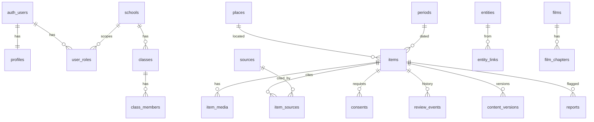

# مخطط قاعدة البيانات

> ✅ = منفّذ ومختبَر في `supabase/migrations/` · ⏳ = مخطط لمرحلته

## المبادئ
- كل جدول في `public` عليه RLS، ويختبر ذلك `supabase/tests/rls.test.mjs` (يفشل إن وُجد جدول بلا RLS أو بلا سياسات).
- تغيير حالة المحتوى عبر `transition_status()` فقط؛ أي تحديث مباشر للحالة يُرفض.
- الدوال الحساسة `security definer` مع `search_path = ''`.
- كل جدول محتوى فيه `is_demo` ويُحذف التجريبي كله بـ`admin_purge_demo()`.
- البحث العربي: عمود مولّد `search_norm = ar_normalize(...)` + فهرس trigram.

## المرحلة 1 — الأساس ✅

| الجدول | الغرض | من يقرأ | من يكتب |
|---|---|---|---|
| `profiles` | اسم عرض، لغة، `is_minor` | صاحبه، الطاقم | صاحبه |
| `user_roles` | الأدوار (مع `school_id` للأدوار المدرسية) | صاحبه، المدير، مدير المدرسة لمدرسته | المدير؛ مدير المدرسة يمنح «معلم» في مدرسته فقط |
| `schools` | المدارس | العامة إن `public_listing`، الأعضاء، الطاقم | المدير؛ مدير المدرسة يعدّل مدرسته |
| `classes` | الصفوف + `join_code` | المعلم، مدير المدرسة، طلاب الصف، المدير | المعلم في مدرسته |
| `class_members` | الطالب باسم مستعار فقط | الطالب نفسه، معلمه، مدير مدرسته، المدير | `join_class()`؛ الحذف للمعلم |
| `places` | محافظات/ألوية/تجمعات/مواقع + إحداثيات | الجميع | الطاقم |
| `periods` | فترات زمنية (سنوات سالبة = ق.م حتى −2.6 مليون) | الجميع | الطاقم |
| `sources` | المصادر والاستشهادات | الطاقم، منشئها، والعامة إن ارتبطت بمادة منشورة | أي مستخدم مسجل يضيف؛ الطاقم يعدّل |
| `items` | وحدة الأرشيف: النوع، العنوان، الحالة، درجة التوثيق، الحقوق، المكان، الزمن | المنشور للجميع؛ صاحبها؛ الطاقم؛ معلم الطالب لعمل طالبه | صاحبها في `draft/rejected`؛ الطاقم |
| `item_sources` | ربط المادة بمصادرها + موضع الاستشهاد | يتبع المادة | يتبع صلاحية تعديل المادة |
| `item_media` | الملفات: مسار التخزين/رابط، النوع، الحجم، النص البديل، التفريغ، الترجمة | يتبع المادة | يتبع المادة |
| `consents` | الموافقة الموثقة: النص ونسخته والطريقة والدليل وتاريخ السحب | صاحبها والطاقم فقط — **لا تُعرض للعامة أبداً** | صاحب المادة؛ السحب عبر `withdraw_consent()` |
| `review_events` | تاريخ انتقالات الحالة مع السبب | الطاقم، صاحب المادة | `transition_status()` فقط |
| `reports` | بلاغات (عدم دقة، حقوق، خصوصية، إساءة) | الطاقم، المبلِّغ | أي أحد يبلّغ عن مادة يراها؛ الطاقم يعالج |
| `content_versions` | لقطة قبل كل تعديل | الطاقم | trigger فقط؛ الاسترجاع `admin_restore_version()` |
| `settings` | مفاتيح الميزات (منها `assistant.enabled`) | العامة للمفاتيح العامة، المدير للكل | المدير |
| `audit_log` | سجل تدقيق إلحاقي فقط | المدير | triggers ودوال فقط — لا تعديل ولا حذف لأي أحد |
| `rate_limits` | عدادات حدود المعدل | لا أحد مباشرة | `check_rate_limit()` |

**قواعد مفروضة بالـtriggers:** المساهم لا يحدد الحالة أو درجة التوثيق أو `is_demo`؛ عمل الطالب يُعلَّم تلقائياً ويُحذف اسمه العام؛ النشر يتطلب درجة توثيق وحقوقاً ومصدراً، والشهادة الشخصية تتطلب موافقة سارية؛ سحب الموافقة يؤرشف المادة فوراً.

## المرحلة 2 — الأرشيف والخريطة والزمن العميق ⏳
- Storage buckets: `media-public` (منشور، عبر CDN)، `media-private` (مسودات، روابط موقعة)، مع سياسات تتبع `can_read_item`/`can_edit_item`.
- `item_media.derivatives jsonb` — أحجام الصور المولّدة.
- `deep_time_stops` — محطات الزمن العميق (سنة، مستوى تكبير، فترة، مادة مرتبطة).
- طرق عرض: `place_item_counts` (للخريطة وخريطة الفراغات).
- `bulk_imports` + `bulk_import_rows` — الرفع الجماعي من Excel بمعاينة وأخطاء لكل صف.

## المرحلة 3 — الشبكة والأفلام والأصوات ⏳
- `entities` (حدث، شخص، منظمة، وثيقة…) بنفس دورة المراجعة والتوثيق.
- `entity_links (from_type, from_id, to_type, to_id, relation, source_id)` — شبكة الرواية بأنواع عامة.
- `films`, `film_chapters`, `film_tracks` (ترجمات WebVTT), `film_links` (أحداث وأماكن), للمدير فقط كتابةً.
- `event_perspectives` — روايات الحدث، كل منها مرتبط بمصادره ودرجة توثيقه.

## المرحلة 4 — التسجيلات والمساعد واللهجات ⏳
- `interview_prompts`, `recordings` (حالة الرفع والتفريغ)، `transcripts` (نسخ قابلة للتعديل).
- `item_chunks (item_id, chunk, embedding vector)` بامتداد pgvector — تُملأ فقط عند النشر وتُحذف عند الأرشفة/سحب الموافقة.
- `assistant_queries` — سجل مختصر بلا بيانات شخصية لأغراض الجودة وحد المعدل.
- `dialect_words`, `dialect_recordings (word_id, place_id, item_id)`.

## المرحلة 5 — المسارات والألعاب والمدارس ⏳
- `trails`, `trail_stops (lat, lng, radius_m, qr_token, item_id)`.
- `cases`, `case_documents`, `case_submissions (student_id, claim, evidence jsonb)`, `case_grades (rubric jsonb)` — الطالب يرى تقديمه فقط، المعلم يرى صفه.
- `quizzes`, `quiz_sessions`, `quiz_answers` + Realtime channel لكل جلسة؛ اللوحة العامة تعرض المدارس فقط.
- `exhibitions`, `exhibition_items` (`visibility`: خاص/برابط/عام، `share_token`).
- `capsules` — الرسالة مقروءة لصاحبها والمراجع فقط حتى `capsule.open_date`، ثم للعامة إن نُشرت.
- `gap_missions` — مهمات توثيق مولدة من خريطة الفراغات.
